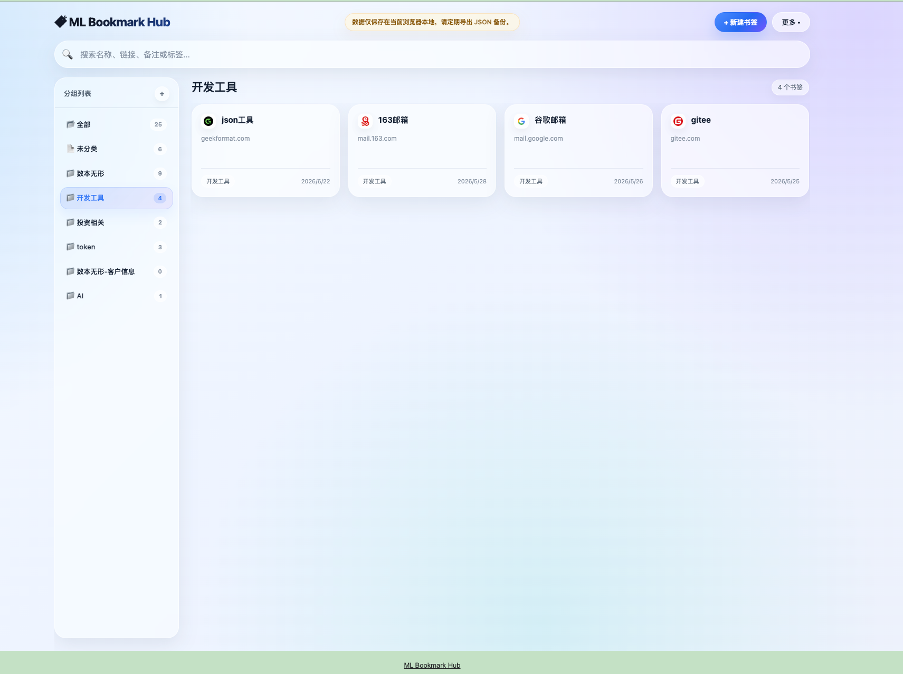

# ML Bookmark Hub

一个简洁的新标签页书签管理插件，帮你在本机整理和快速访问常用书签。



## 功能特性

- 分组管理 - 创建、编辑、删除书签分组
- 搜索过滤 - 支持按名称、链接、备注和标签搜索
- 标签系统 - 为书签添加多个标签
- 笔记备注 - 为书签添加备注信息
- 本地存储 - 书签数据保存在当前浏览器本地
- 导入/导出 - JSON 格式备份和恢复，导入时自动跳过重复链接

## 安装使用

### 1. 安装插件

1. 打开 Chrome，访问 `chrome://extensions/`
2. 开启右上角「开发者模式」
3. 点击「加载已解压的扩展程序」
4. 选择本项目的 `ml-bookmark-hub` 文件夹

### 2. 开始使用

安装完成后，新建标签页即可打开 ML Bookmark Hub。如果没有自动生效，请在扩展程序页面确认扩展已启用，然后重新打开一个新标签页。

### 3. 日常使用

- 点击「新建书签」添加书签
- 点击左侧分组名称切换分类
- 搜索框支持按名称、链接、备注和标签搜索
- 右上角菜单可导入/导出数据

## 数据存储与备份

插件使用 `chrome.storage.local` 存储数据，数据只保存在当前 Chrome 个人资料中。

- 不依赖 Google 云同步
- 换电脑不会自动同步，需要导出 JSON 后在新电脑导入
- 导入前会自动导出一份当前数据备份
- 导入时会合并数据，并自动跳过重复链接

> 注意：卸载扩展、清理浏览器数据、删除 Chrome 个人资料或重装系统都可能导致数据丢失。请定期通过「导出 JSON」备份。

## 项目结构

```
ml-bookmark-hub/
├── manifest.json   # Chrome 扩展配置
├── index.html      # 插件主页面
├── app.js         # 核心逻辑
├── styles.css     # 样式文件
├── icons/         # 图标资源
├── main.png       # README 界面截图
└── README.md      # 使用说明
```

## 技术栈

- 原生 JavaScript（无框架依赖）
- Chrome Extensions Manifest V3
- chrome.storage API

## 个人主页

[https://www.muluov.com/](https://www.muluov.com/)

## License

MIT
